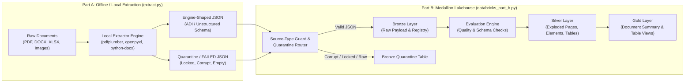

# Document Extraction to Lakehouse (Part A & Part B)

An end-to-end, production-grade document extraction and medallion lakehouse pipeline.



---

## Deliverables in This Project

| File | Purpose | Environment |
|---|---|---|
| [`chunker.py`](file:///c:/Users/jaffe/OneDrive/Desktop/antigravity_extraction_proj/chunker.py) | Intelligent, table-aware document pre-processor & chunker (up to 10,000+ pages) | Local / CLI / Server |
| [`table_stitcher.py`](file:///c:/Users/jaffe/OneDrive/Desktop/antigravity_extraction_proj/table_stitcher.py) | 7-point confidence metric multi-page table reconstructor & deduplicator | Local / Module |
| [`aggregator.py`](file:///c:/Users/jaffe/OneDrive/Desktop/antigravity_extraction_proj/aggregator.py) | Extraction aggregation, 1..N page reconciliation, and lab domain projection | Local / Module |
| [`extract.py`](file:///c:/Users/jaffe/OneDrive/Desktop/antigravity_extraction_proj/extract.py) | Standalone CLI extractor converting documents to engine-shaped JSON | Local / CLI / Server |
| [`requirements.txt`](file:///c:/Users/jaffe/OneDrive/Desktop/antigravity_extraction_proj/requirements.txt) | Python dependencies for extraction and cloud connectors | pip / virtualenv |
| [`config.yaml`](file:///c:/Users/jaffe/OneDrive/Desktop/antigravity_extraction_proj/config.yaml) | Configuration options (OCR toggle, thresholds, limits) | Local / CLI |
| [`databricks_part_a.py`](file:///c:/Users/jaffe/OneDrive/Desktop/antigravity_extraction_proj/databricks_part_a.py) | Databricks notebook version for document extraction | Databricks (Free / Org) |
| [`databricks_part_b.py`](file:///c:/Users/jaffe/OneDrive/Desktop/antigravity_extraction_proj/databricks_part_b.py) | Full Medallion Lakehouse Databricks Notebook (Cells 1-19) | Databricks (Free / Org) |
| [`test_scale_pipeline.py`](file:///c:/Users/jaffe/OneDrive/Desktop/antigravity_extraction_proj/test_scale_pipeline.py) | 15 comprehensive automated test suites for scale (10 to 10,000 pages) | Local / pytest |
| [`test_adi_pipeline.py`](file:///c:/Users/jaffe/OneDrive/Desktop/antigravity_extraction_proj/test_adi_pipeline.py) | Verification against real Azure Document Intelligence payloads | Local / pytest |
| [`test_extract.py`](file:///c:/Users/jaffe/OneDrive/Desktop/antigravity_extraction_proj/test_extract.py) | Unit test suite for extraction logic and edge cases | Local / pytest |
| [`sample_data/`](file:///c:/Users/jaffe/OneDrive/Desktop/antigravity_extraction_proj/sample_data) | Test document payloads and error test cases | Test datasets |

---

## Part A: Document Extraction Engine

Part A converts files into standardized JSON mirroring output from production cloud engines (Azure Document Intelligence or Unstructured), eliminating cloud credentials, SaaS subscription fees, and API rate limits during development.

### Supported File Formats

- **PDF (`.pdf`)**: Native text layer, scanned pages, mixed documents, embedded images, tables. Handled via `pdfplumber` and `PyPDF2`/`pypdf`. Optional OCR fallback via `pytesseract`.
- **Images (`.png`, `.jpg`, `.jpeg`, `.tif`, `.tiff`)**: Treated as single-page scanned documents. Uses `pytesseract` when enabled or extracts dimensions and metadata.
- **Excel (`.xlsx`, `.xls`)**: Handled via `openpyxl`. Models each sheet as a table with full calculation of merged cells (`row_span` and `column_span`).
- **Word (`.docx`)**: Handled via `python-docx` + `zipfile`/`Pillow`. Extracts headings, body paragraphs, tables, and embedded images.
- **JSON (`.json`)**: Passthrough mode for pre-extracted documents.

### Resilient Error Handling (No Crashing)

When encountering locked, corrupted, or unsupported files, `extract.py` does **not** fail the batch. It emits a structured failure contract:

```json
{
  "status": "FAILED",
  "error_class": "ENCRYPTED_PDF",
  "error_message": "PDF file is encrypted or password-protected.",
  "source_file": "confidential_payroll.pdf",
  "detected_at": "2026-11-19T10:00:00.000000+00:00"
}
```

Standard error classes:
- `ENCRYPTED_PDF` / `ENCRYPTED_FILE`: Password-protected PDF or Excel workbook.
- `EMPTY_FILE`: 0-byte file.
- `CORRUPT_FILE`: Malformed headers, unreadable zip structure, or file exceeding max size limit.
- `UNSUPPORTED_FORMAT`: File extensions outside the supported set.
- `UNREADABLE`: File system permission errors or missing drivers.

### Standard Engine-Shaped JSON Output (Successful Extraction)

```json
{
  "status": "SUCCESS",
  "source_file": "quarterly_report.pdf",
  "engine": "local",
  "model_version": "local-v1",
  "extracted_at": "2026-11-19T10:00:00.000000+00:00",
  "page_count": 2,
  "pages": [
    {
      "page_number": 1,
      "width": 612.0,
      "height": 792.0,
      "is_scanned": false,
      "lines": [
        { "text": "Report Title", "bbox": [50.0, 720.0, 200.0, 740.0], "confidence": 1.0 }
      ]
    }
  ],
  "elements": [
    {
      "page_number": 1,
      "element_index": 0,
      "type": "heading",
      "text": "Report Title",
      "bbox": [50.0, 720.0, 200.0, 740.0],
      "confidence": 1.0
    }
  ],
  "tables": [
    {
      "table_id": "tbl_7a8f9b",
      "start_page": 1,
      "end_page": 1,
      "is_cross_page": false,
      "row_count": 5,
      "column_count": 3,
      "caption": "Revenue Table",
      "cells": [
        { "row_index": 0, "column_index": 0, "row_span": 1, "column_span": 1, "text": "Quarter" }
      ]
    }
  ],
  "figures": [],
  "extraction_metadata": {
    "page_count_in_source": 2,
    "pages_with_text": 2,
    "pages_without_text": 0,
    "tables_detected": 1,
    "figures_detected": 0,
    "warnings": []
  }
}
```

### Heuristic Cross-Page Table Detection

Tables spanning consecutive pages are linked automatically:
1. Column count of table on page $N$ is compared to table on page $N+1$.
2. The first row of page $N+1$ is evaluated for continuation (does not contain standard table header keywords like `id`, `name`, `amount`, `item`).
3. If confirmed, tables are merged: `start_page = N`, `end_page = N+1`, `is_cross_page = true`, with automatic cell row offset recalculation.
4. If in doubt, tables are kept separate and a warning is logged.

### Running Part A CLI

```bash
# 1. Install dependencies
pip install -r requirements.txt

# 2. Run extraction
python extract.py --input ./sample_docs --output ./extracted_json --config config.yaml

# Flags:
#   --overwrite     Force overwrite of existing outputs
#   --enable-ocr    Enable pytesseract OCR fallback for scanned pages
```

A sidecar log file `extracted_json/extraction_log.jsonl` records execution timing, status, and warnings for every processed file.

---

## Part B: Medallion Lakehouse Pipeline

Part B consumes the JSON files generated by Part A (or cloud engines), validates and evaluates payloads, prevents duplicates, handles quarantines, and transforms data into Delta Bronze, Silver, and Gold tables.

### 1. Dual-Environment Portability

The entire notebook ([`databricks_part_b.py`](file:///c:/Users/jaffe/OneDrive/Desktop/antigravity_extraction_proj/databricks_part_b.py)) runs in two environments without code restructuring:

1. **Free Edition (`ENV = "FREE_EDITION"`)**:
   - Runs on Databricks Free / Community Edition serverless compute.
   - Disables Unity Catalog (`USE_UNITY_CATALOG = False`).
   - Uses local workspace file path connector (`SOURCE_TYPE = "local"`).
   - Zero outbound internet or secret scope requirements.
2. **Enterprise Workspace (`ENV = "ORG_WORKSPACE"`)**:
   - Unity Catalog enabled (`USE_UNITY_CATALOG = True`).
   - Remote storage volumes and connectors (S3, Azure Blob, ADLS Gen2, SFTP).
   - Secure credential retrieval via `dbutils.secrets`.

### 2. Available Source Connectors

All source connectors are fully implemented:
- `connector_s3()` (`boto3`)
- `connector_blob()` (`azure-storage-blob`)
- `connector_adls()` (`azure-storage-file-datalake`)
- `connector_sftp()` (`paramiko`)
- `connector_local()` (`dbutils.fs` / workspace filesystem)

Each connector features:
- Exponential backoff on HTTP 429/5xx and network drops.
- Configurable per-source rate limiting (`requests_per_second`).
- Partial download verification (exact byte count match).
- Checkpoint persistence in `bronze_source_checkpoint`.

### 3. Medallion Table Architecture

```
Landing / Source
   │
   ▼
[Source Guard] ────► bronze_quarantine (Raw docs, corrupt JSON, upstream FAILED payloads)
   │
   ▼
bronze_document_registry (SHA-256 deduplication & redelivery guard)
   │
   ▼
bronze_raw_engine_output (Full raw JSON stored unmodified)
   │
   ▼
bronze_evaluation_results (8 Quality gates: page coverage, structure, non-empty)
   │
   ▼
[Silver Adapters: ADI, Unstructured, Local]
   ├── silver_pages (Document-absolute page numbering across segments)
   ├── silver_elements (Continuous reading_order via window function)
   ├── silver_tables (Deterministic table IDs and cross-page flags)
   └── silver_table_cells (Spans, coordinates, text)
   │
   ▼
[Gold Projections]
   ├── gold_extracted_table_view (Flattened cell-to-table projection)
   └── gold_document_summary (Document status, table counts, quality metrics)
```

### 4. Transitioning from Free Edition to Org Workspace

Update configuration in **Cell 2**:
```python
# === CHANGE IN ORG WORKSPACE ===
ENV = "ORG_WORKSPACE"
USE_UNITY_CATALOG = True
CATALOG_CONFIG = {"catalog": "prod_lakehouse", "schema": "document_ai"}
SOURCE_TYPE = "s3"  # or "blob", "adls", "sftp"
SECRET_SCOPE_NAME = "document_pipeline_scope"
STORAGE_CONFIG["landing_path"] = "/Volumes/prod_lakehouse/document_ai/landing"
```

Create required secrets:
```bash
databricks secrets create-scope document_pipeline_scope
databricks secrets put-secret document_pipeline_scope aws_access_key_id
databricks secrets put-secret document_pipeline_scope aws_secret_access_key
```

---

## Testing & Verification

Run the test suite locally:
```bash
pytest test_extract.py -v
```

Tests cover:
- Failure JSON contracts (`make_failed_json`).
- Deterministic table ID generation.
- Cross-page table continuation detection vs. header-keyword separation.
- Zero-byte file quarantine (`EMPTY_FILE`).
- Unsupported file extension detection (`UNSUPPORTED_FORMAT`).
- JSON passthrough verification.
- Pipeline idempotency and skip logic.
